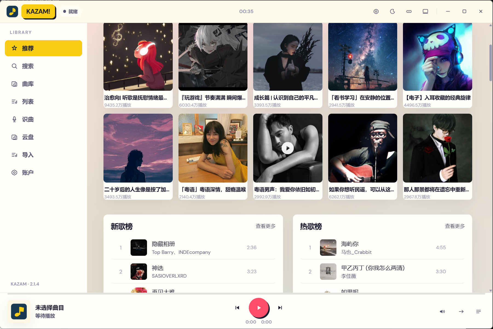
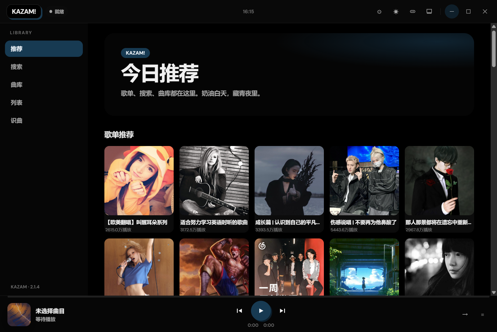

# KAZAM

A Windows x64 desktop music player built with Electron, React, and TypeScript—combining multi-platform catalog search, sandboxed LX custom audio sources, word-by-word lyrics, and desktop lyric overlays.

English · [简体中文](README.zh-CN.md)

| Light Mode | Dark Mode |
| --- | --- |
|  |  |

## Features

- **Multi-platform search** — Queries tracks, albums, playlists, and charts across NetEase Cloud Music, QQ Music, Kuwo, and Kugou from a single interface.
- **Hybrid playback routing** — Pairs built-in `eapi` resolution with sandboxed LX custom source scripts under smart-fallback, priority, or exclusive routing modes.
- **Word-by-word lyrics & visuals** — Full-screen playback view powered by `@applemusic-like-lyrics` (AMLL), real-time cover spectrum rendering, and cream-light / navy-dark themes.
- **Library & cloud storage** — Local audio folder scanning, WebDAV streaming, song recognition, multi-part downloads, and SQLite-backed playlists and favorites (`%AppData%\Roaming\gz-music`).
- **Windows desktop integration** — Floating Dynamic Island lyric capsule, embedded taskbar playback strip, and System Media Transport Controls (SMTC) hardware key support.

## Quick Start

Requires **Windows 10/11 (x64)** and **Node.js 20+**.

```bash
git clone https://github.com/zzzfu411/kazamusic.git
cd kazamusic
npm install
npm run dev
```

Build a standalone portable bundle (`release/KAZAM-win32-x64/KAZAM.exe`):

```bash
npm run dist:exe
```

`npm run dev`, `npm run build:vite`, and `npm run dist:exe` target the first-party `src/` + `electron-vite` pipeline; `npm run build` retains the legacy `asar` injection build. Application state stays in `%AppData%\Roaming\gz-music` to preserve existing local libraries.

## Development & Project Structure

```bash
npm run typecheck   # TypeScript compiler check
npm run build:vite  # compile main, preload, and renderer bundles into out/
npm test            # shipped bundle and theme regression assertions
```

```text
src/
├── main/      Electron main process shell and vendored IPC bridge
├── preload/   Context-isolated bridges for main window, island, and taskbar
├── renderer/  React UI, theme tokens, search views, and AMLL lyric player
├── island/    Floating desktop lyric capsule entry
├── taskbar/   Embedded Windows taskbar mini-player entry
└── shared/    Shared theme resolution, metadata, and plugin types
scripts/       Build, portable packaging, and CDP inspection scripts
```

- [docs/brand.md](docs/brand.md) — Typography, color palette, and visual identity notes
- [docs/ipc-map.md](docs/ipc-map.md) — Main/renderer IPC channel contracts
- [docs/rebuild-status.md](docs/rebuild-status.md) — `electron-vite` migration status and remaining main-process splits

---

For personal learning and private use only; comply with the terms of service of each music platform.
